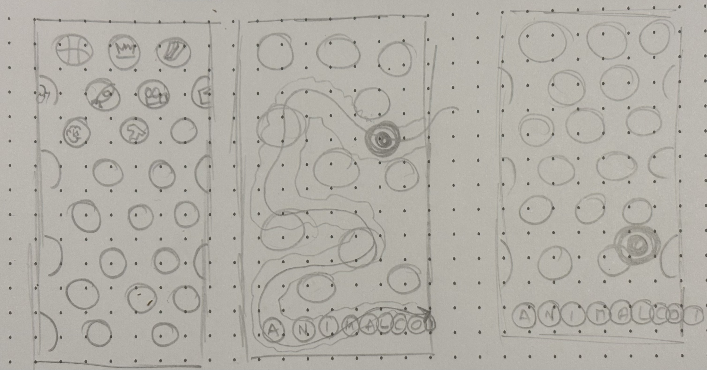

# visuals_to_screen
Disseny en Moviment

## Disseny en moviment
[Bases](https://animalcoi.com/edicio-2026/disseny-en-moviment/)

## Proceso
### PRIMERA VÍA
#### Boceto

#### Concepto
1. Animación del ojo
   - El puntero se convierte en un ojo
   - El lienzo tiene elementos y el ojo se mueve entre ellos (se dispersan a su alrededor)
   - Cuando haces un click el ojo se invierte y cambia (mira de izquierda a derecha o al revés)
   - Hay un texto oculto bajo los elementos, cuando mantienes pulsado los elementos de esa zona se mueven o cambian a texto.
#### Tutoriales
_Sobre el puntero_
- [Interactividad](https://processing.org/tutorials/interactivity/)
- [Ocultar cursor](https://processing.org/reference/noCursor_.html)
- [Cambiar cursor](https://processing.org/reference/cursor_)
_Interactividad con el puntero_
- [Vectores](https://natureofcode.com/vectors/)
- [Fuerzas](https://natureofcode.com/forces/)
- [Agentes autónomos](https://natureofcode.com/autonomous-agents/)
_Sobre el texto_
- [Tipografía](https://processing.org/tutorials/typography/)
